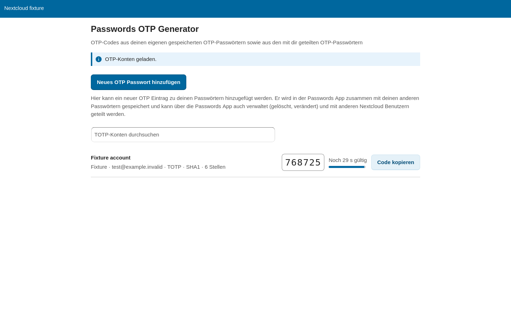

# User guide

The app in [v1.1.3](https://github.com/RamonP12/nextcloud-passwords-otp-extension/releases/tag/v1.1.3) appears as **Passwords OTP Generator** in Nextcloud navigation and on the administrator’s Apps page. The icon is a shield with a diagonal key cut-out. Published version 1.1.2 appears as **Passwort OTP Code Generator**. If the Apps page still shows the old shield after an update, see the [icon cache workaround](VALIDATION_1.1.3.md#apps-administration-icon-cache).

## Interface language

The published 1.1.3 interface is German. The 1.1.4 multilingual interface uses the first supported language in your browser preferences. For example, German (Switzerland) selects German, and French with no other supported preference selects English. Put your preferred supported language first in the browser, then reload the page or reopen the app. The Nextcloud menu can use a different language set by your account or administrator.

The steps below show the published German labels. In English, use **Search TOTP accounts**, **Copy code**, **Add a new OTP entry**, **Save OTP** and **Cancel**. See [localization](LOCALIZATION.md) for details.

## Required Passwords app

Users need access to both apps. Published 1.1.3 requires Passwords **2026.11.20** and can require explicit OTP reactivation after restoring Passwords. In 1.1.4, dependency loss blocks access at runtime. Once a compatible Passwords installation returns, reload the OTP page. [Dependency lifecycle](DEPENDENCY_LIFECYCLE.md)

The interface cannot revoke a code already copied to another application. Normal session/window checks remain active. See [dependency lifecycle](DEPENDENCY_LIFECYCLE.md) for detection timing and administrator recovery.

## View and copy codes

1. Sign in to Nextcloud and open the OTP app.
2. If requested, complete the Passwords master-passphrase/CSE or supported secondary-factor challenge. A wrong master passphrase can be corrected without resubmitting other operations.
3. Find the account in the valid TOTP list. It can contain your own Passwords entries and entries shared with you through the original app.
4. Click the displayed code or activate **Code kopieren** for that account. Both controls support Tab, Enter and Space. In 1.1.2, use **Code kopieren**. Enter the copied code promptly in the service requesting it.
5. Use **TOTP-Konten durchsuchen** to filter accounts; clear the search to restore the list. Searching does not discard accounts or reset their valid codes.

Copying is temporarily unavailable close to expiry or while session validity is being checked. In **1.1.4**, returning to the window shows a message while the session check runs. When the code reappears, click it or **Code kopieren** again. A failed clipboard request is reported rather than presented as success. Leading zeroes are part of the code.

Codes change according to each account's configured period. Incorrect device time can prevent verification. HOTP and invalid or unsupported configurations do not produce TOTP codes; the interface explains omitted records when applicable.

## Create a new OTP entry

Choose **Neues OTP Passwort hinzufügen**. The app checks access before opening the dialog. Supply a title, the service account's password and its **Base32 TOTP setup secret**. A username is optional. This password is not the Nextcloud master passphrase.

Creation uses **SHA-1, six digits and a 30-second period**. Check these settings against the service before saving. New secrets must meet the application's minimum-length validation.

Choose **OTP speichern** to confirm. Pressing Enter in an input field does not create an entry; keyboard activation of the save button still works. **Abbrechen** or Escape closes an idle dialog and clears the secret fields. While a save is in progress, closing and repeated submission are disabled. On completion the new record is stored together with your other passwords in the original Passwords app. Use the Passwords app to edit, delete or share it with other Nextcloud users.

Switching tabs clears the password and OTP secret in the open dialog. The title and username stay filled. Version 1.1.4 shows a message so you know to re-enter the cleared fields.

If the interface reports an uncertain save result, verify the original Passwords records before attempting another create operation. The app blocks a blind retry because the first request might already have been stored.

## Session and keyboard behavior

In 1.1.4, OTP reads the Passwords inactivity duration and
keepalive mode from the API when the vault opens. The default duration is
**600 seconds**. Reload OTP to apply a setting changed in Passwords.

| Passwords mode | OTP behavior |
| --- | --- |
| Explicit always keep alive (0) | The local inactivity timer is disabled. |
| Keep alive on activity (1) or no explicit mode | Trusted keyboard, pointer and form input in OTP extend the deadline. |
| Keep alive only on requests (2) | Only user actions that require a Passwords request, such as opening or saving the new-entry form, extend the deadline. |

The periodic Nextcloud login checks never extend the OTP deadline. OTP sends
no periodic Passwords keepalive requests. When the vault locks, the app clears
codes and form secrets. Reload to open a fresh vault session. If the lock
occurred during a save, check Passwords for the entry before trying again.
[Passwords keepalive modes in upstream source](https://git.mdns.eu/nextcloud/passwords/-/blob/2026.11.0/src/js/Manager/KeepAliveManager.js)

The app checks login validity before new mandatory time windows and when returning to the page. Leaving or hiding the page clears displayed codes and secret inputs; focus restoration requires appropriate verification before codes are shown again. Navigating away and returning through browser history can require a reload and fresh vault authentication.

Keyboard focus follows the active form/dialog and returns to the opener when an idle create dialog closes. Errors distinguish authentication, validation, rate-limit and clipboard problems. If Nextcloud or the Passwords API session expires, reload or sign in as prompted. Signing out cannot revoke a code that has already been copied.

Use a trusted browser. Browser extensions and clipboard history can retain sensitive data. Never place a real OTP setup secret, master passphrase, token or cookie in a bug report. See [Security review](SECURITY_REVIEW.md) for the unchanged architecture and threat boundaries.
