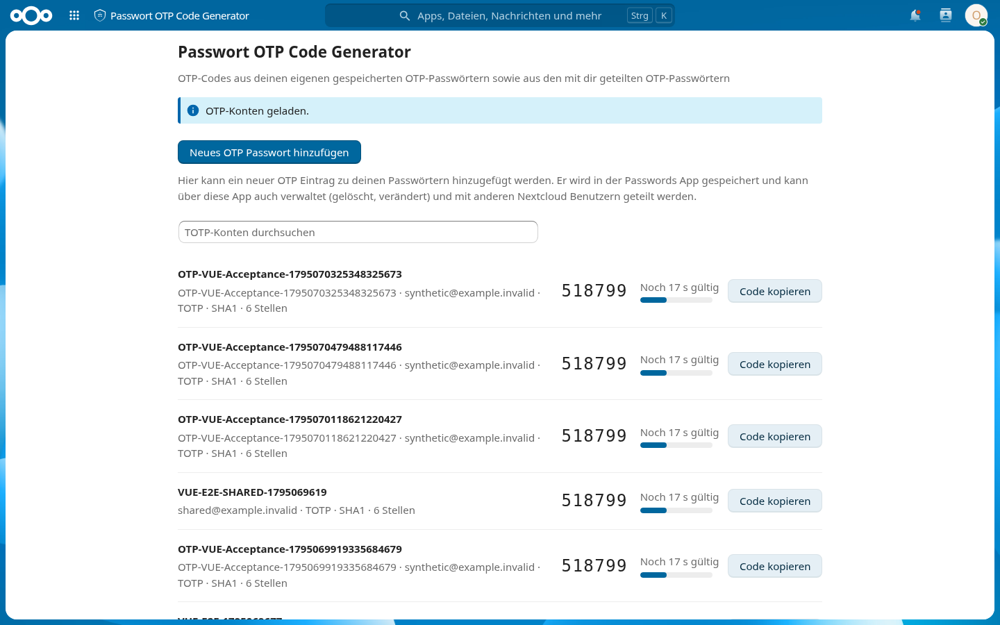
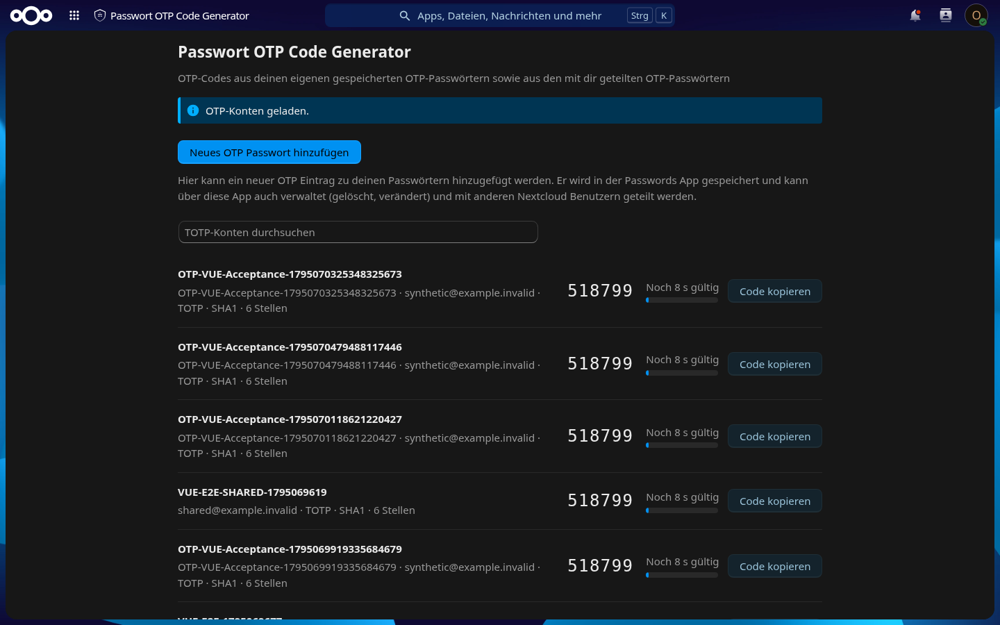
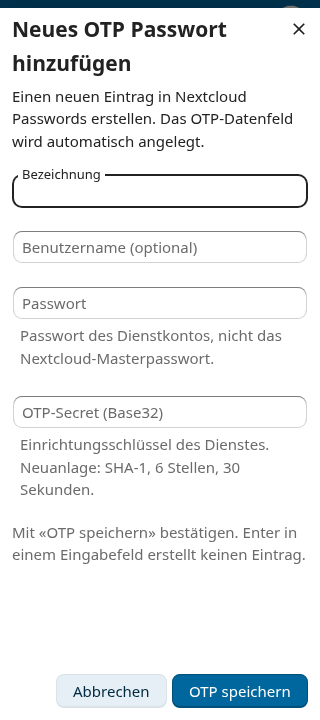

# Validation record — Nextcloud Vue 1.1.0 candidate

**Assessment date:** 2026-11-19. **Result:** the implementation, local regression suites, installed-server acceptance and deterministic package gate passed within the scope below. This is an unreleased source candidate, not a production deployment or signed App Store release.

## Source and artifact identity

The complete runtime, tests, build configuration and packaging code were checked at implementation commit **`2e0530a051336966c9c3971b34935d6bc8eb8182`**. This validation-only follow-up adds evidence and screenshots; it does not change runtime source, tests, dependencies or packaging behavior. The original migration began at main commit `e2eb88c5dd046a5a16e7fe7b0d42a5bfa08ce0ff`.

| Artifact | Bytes | SHA-256 |
| --- | ---: | --- |
| `js/app-110.mjs` | 1,079,782 | `ffae372e62c8d6284974bc01cae36fb7135cad5692cb3dfb9308231c427d07e7` |
| `css/app-110.css` | 62,590 | `9aff12f7d35d5777f3f6082242894107e7bfc923f0e31bd7d25fcbcbf42b729f` |
| Source-bound `passwords_otp-1.1.0.zip` | 593,507 | `a015213eff8bb6041a11c7f61b5062e64ba6e603e92b1c9191d2b238490405de` |
| Generated `THIRD_PARTY_LICENSES.txt` | 949,397 | `0021459fd114b1093161299e8943346885b7959218d517e5863ee3a40a30ebdf` |

The ZIP hash identifies the archive made from the implementation commit, before adding this evidence. Packaging another commit deliberately changes `BUILD.json` and the ZIP hash even when the runtime payload is unchanged. The package has **`production_approved=false`** and is not signed.

The clean gate compared **two complete frontend compilations** and **two archive constructions** byte for byte. Both comparisons passed. All four browser reports below match the exact final JS/CSS hashes, and each suite verifies that the assets remain unchanged throughout its run. The real-server runner also compares the fetched `.mjs` bytes against the local artifact.

### Machine-readable evidence

- [Clean source build receipt](validation/vue-1.1.0/build-pass.json)
- [Frontend input and module inventory](validation/vue-1.1.0/bundle-modules.json)
- [PHP, official metadata schema and unchanged-core checks](validation/vue-1.1.0/additional-checks.json)
- [Chromium production-bundle regressions](validation/vue-1.1.0/browser-chromium.json)
- [Firefox production-bundle regressions](validation/vue-1.1.0/browser-firefox.json)
- [Actual Nextcloud acceptance in Chromium](validation/vue-1.1.0/nextcloud-chromium.json)
- [Actual Nextcloud acceptance in Firefox](validation/vue-1.1.0/nextcloud-firefox.json)

These are local results and reports, not signed third-party attestations. Fixture credentials, master passwords, session cookies, tokens and HTTP bodies are excluded from the published reports. Screenshots contain only synthetic accounts and public RFC test data.

## Test results

| Layer | Final result | What was checked |
| --- | ---: | --- |
| JavaScript | **237/237 passed** | Existing parser/crypto/transport/session/create behavior plus presenter, controller and failure-boundary regressions |
| Actual pinned Passwords client | **17/17 passed** | Real client/libsodium code with controlled API responses, CSE/challenges and creation |
| Python | **82/82 passed** | Packaging, exact inputs, notices, tamper rejection, AIO first-install limits, local install and rollback contracts |
| PHP | **51 assertions passed** | Authentication, CSRF, session binding and controller contracts on PHP 8.4.24; framework doubles |
| PHP syntax | **6/6 files passed** | All tracked PHP files, including the changed template/controller |
| App metadata | **Passed** | `appinfo/info.xml` against the official Nextcloud 35 `resources/app-info.xsd` |
| Compiled browser suite, Chromium | **30/30 passed** | Actual production bundle, real client and WebCrypto, controlled HTTPS API/shell; lifecycle, errors, keyboard and layout |
| Compiled browser suite, Firefox | **30/30 passed** | The same suite and actual compiled assets in Firefox |
| Installed Nextcloud, Chromium | **29/29 groups passed, 0 skipped** | Actual server/API/session/CSE/share/create behavior plus real themes, branding, layout and axe |
| Installed Nextcloud, Firefox | **6/6 groups passed, 0 skipped** | Actual server core/share/create/CSE/session/group behavior |
| Dependency audit | **0 reported vulnerabilities** | Complete locked tree, including development dependencies; `npm audit --audit-level=low` |
| Deterministic frontend | **Passed** | Two production compilations with identical JS and CSS bytes |
| Deterministic ZIP and validation | **Passed** | Two identical archive constructions; source identity, exact files, source freshness, hashes, limits and notices |

Counts describe different kinds of checks and must not be added into an undifferentiated total. The six lifecycle cases are already included in each 30-case compiled-browser result. No historical v1.0.0 totals are counted here.

### Runtime and tool versions

| Component | Version used |
| --- | --- |
| Nextcloud | 35.0.2 release, internal 35.0.2.2 |
| Passwords | Package release 2026.11.0; installed `info.xml` version 2026.11.20 |
| PHP | 8.4.24 |
| Disposable server database | SQLite |
| Chromium | 150.0.7871.181, headless shell |
| Firefox | 153.0, Playwright-managed browser |
| Python / Playwright | 3.12.14 / 1.62.0 |
| Node.js / npm | 24.22.3 / 11.9.0 |
| Vue / Nextcloud Vue | 3.5.45 / 9.14.1 |
| Vite / official Vue plugin | 7.3.8 / 6.0.11 |
| axe-core | 4.14.1 |
| Passwords client / libsodium wrapper | 1.0.0-beta.6117 / 0.8.4, unchanged versions |

The actual Nextcloud and Passwords archives were installed in a disposable loopback HTTPS fixture. Their release sources and the Passwords archive checksum are recorded in the [integration instructions](../tests/integration/README.md). The fixture uses original upstream server code. Its synthetic accounts, group settings and vault records are test setup, not a copy of a user's production installation.

## Actual-server acceptance

The installed-server tests establish that PHP routing and the real Nextcloud shell load the ES module, stylesheet and Vue components under the deployed CSP. They check no-store/referrer headers, consumed initial state, rejected missing-CSRF and mismatched-session requests, and denial of a user outside the enabled group.

The normal user reads a genuine incoming read-only share whose server response has the expected share/editability flags. Displayed OTPs are compared with an independent HMAC implementation using the public RFC 6238 test seed. New entries require an explicit save and create exactly one record. The runner checks no accidental submission through input Enter, filtering, immediate Tab/Shift+Tab containment, Escape, focus restoration and cleared secret fields. The native progress maximum is 30 seconds and its value agrees with the displayed countdown for the known test record.

The CSE account is an actual Passwords master-key/keychain configuration. A wrong master password is rejected and cleared. The correct master password unlocks the vault; creation sends `CSEv1r1` ciphertext without the plaintext setup seed or service password. Readback/listing and an independently verified OTP then exercise real decryption. Expiring the real Nextcloud cookie session removes the protected UI. No edit/delete/restore operation on existing passwords is introduced.

Chromium tests the real clipboard write and independently reads its content. Firefox verifies the successful real user-triggered write; the runner does not claim an independent clipboard read in Firefox.

### Themes, keyboard and accessibility

The real Nextcloud user theme was changed through its OCS API. The test also changed the actual administrator primary brand color and restored it in `finally`. These checks use the server's generated theme, rather than replacing its CSS variables in the browser.

Light and dark list/dialog states passed reflow checks at **1440×900, 1024×768, 640×450 and 320×720**. The modal's topmost-element check confirms that the real Nextcloud header does not cover it. Progress bars have a visible fixed size in the actual shell. The compiled suite additionally covers a custom synthetic theme and right-to-left reflow in both browsers.

The six real-shell axe scans — light, dark and actual brand color, each with list and dialog — reported **zero violations**. The three list scans also had **zero incomplete results**. Dialog scans retain incomplete contrast checks only for app content covered by the active modal, including the empty background search input. The raw targets and summaries remain in the report and are classified as `background-covered-by-active-modal`. The unobscured list was separately checked in the same themes. No such finding targets the active dialog.

This evidence does not constitute complete WCAG certification. Native browser zoom, OS text scaling, manual screen-reader behavior and mobile Safari were not tested. Viewport resizing is reported as reflow, not as a substitute for native browser zoom.

## Security regression boundaries

The following twelve core files are unchanged from the main baseline:

```text
src/ap1/bootstrap.mjs
src/ap1/network.mjs
src/ap1/session.mjs
src/ap1/upstream.js
src/ap2/parser.mjs
src/ap3/totp.mjs
src/ap9/session-check.mjs
src/ap12/api-policy.mjs
src/ap12/create.mjs
lib/AppInfo/Application.php
lib/Service/PasswordsAuthAdapter.php
appinfo/routes.php
```

The migrated controller/presenter adds coverage for synchronous model/DOM clearing, stale asynchronous results, initial render failure before authentication, identical-code restoration, double submit, delayed create acknowledgement, pagehide and BFCache. Unit tests use controlled time and dependencies; compiled-browser tests use the actual Vue bundle and pinned client with controlled network responses. Rate limits and ambiguous-write failures are covered by the latter, rather than manufactured against the real upstream server.

The build inventory records **24 frontend input files**, **21 app modules**, **263 dependency module paths** and **33 contributing package paths**. The license inventory checks **292 production package paths**. Source-input inventory SHA-256: `88e91eda81de8c4eb46b10535eb401d53b5fe5eb65cc2b6a57a17b02269daacb`. The generated license bundle is pinned separately above.

The first clean package attempt at commit `a6612638a41eddd9cb4c6b85e4b94caa3e35f81f` was rejected because CSS minification removed the existing installer marker. No success receipt or candidate ZIP was emitted. The correction preserves that check and adds the fixed marker after minification, before hashing. Verification confirmed that the resulting CSS differs from the prior browser-tested stylesheet only by the 38-byte comment prefix; the JavaScript is byte-identical. The final browser reports and successful clean gate were then regenerated for the corrected artifacts. Failed evidence was not relabelled as a pass.

## Explicit limitations

- **Live Passwords provider 2FA:** the [official feature manifest](https://raw.githubusercontent.com/wiki/marius-wieschollek/passwords/Users/_features/features-v1.json) observed for `server["2026.11"]` sets `two-factor-enabled` to `false`; the released controller gates this challenge accordingly. Upstream feature flags or verification code were not modified to manufacture a live result. Master-password/CSE flows are truly tested; provider-selector/challenge/retry handling is covered by the actual client and compiled browser with synthetic API responses. Ordinary Nextcloud login 2FA is a separate untested layer here.
- **Deployment:** SQLite fixture acceptance does not establish AIO/PostgreSQL, MariaDB, production-proxy behavior or a supported in-place AIO upgrade. No production installation was changed. The existing AIO tool remains first-install only.
- **Version coverage:** the results apply to the exact versions above. The declared PHP range and Nextcloud major limit are not evidence for every possible combination.
- **Distribution:** the candidate is unsigned and unreleased. Existing release tags/assets and separate PR #9 signing work remain unchanged.
- **Architecture:** the upstream WebUI token's broad permissions, same-origin/browser-extension compromise and clipboard history remain documented boundaries. Moving to Vue does not remove them.

## Reproduction and GitHub Actions

Follow [DEVELOPMENT.md](DEVELOPMENT.md) for pinned dependencies and all layer-specific commands, and [tests/integration/README.md](../tests/integration/README.md) for the real fixture. The final clean-source command was:

```sh
python3 scripts/local.py --build
```

PHP contracts/syntax, the official XSD validation, both compiled-browser suites and both real-server suites were run separately. The clean build gate does not claim to run these external acceptance layers itself.

The workflow was manual-only during this migration. The results here came from local checks. See [Development](DEVELOPMENT.md#github-actions) for the active workflow.

## Reviewed screenshots

Actual Nextcloud shell, synthetic test records and the final Vue assets:

### Light theme



### Dark theme



### Create dialog at 320 pixels


